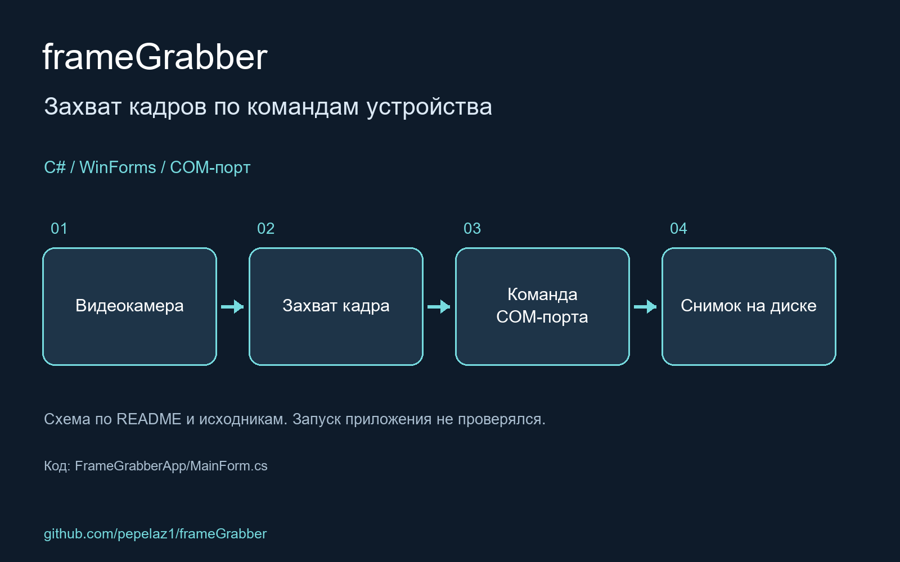

# frameGrabber

C# app which captures frames from connected video camera and receives commands from additionally connected on COM port specific device to save captured frames as screenshots on disk

<!-- portfolio-visual:start -->
## Схема работы

Схема подготовлена по README и исходному коду. Запуск приложения не проверялся.
<!-- portfolio-visual:end -->
